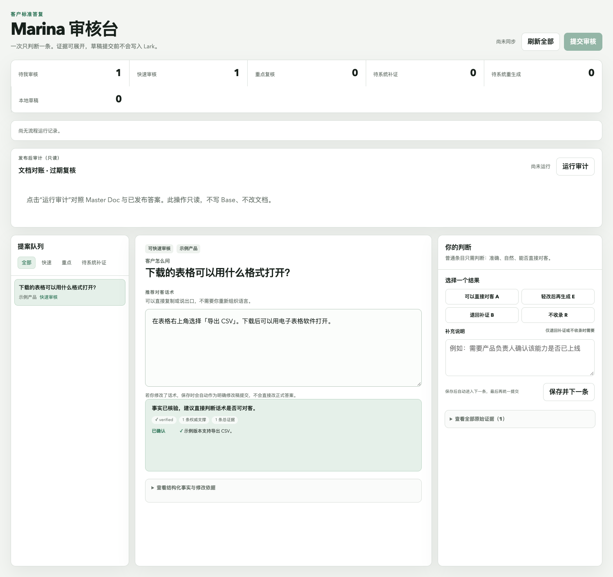

# 我点了「通过」，通过的是哪一版 FAQ？

整理客户 FAQ 时，我在本机搭了一个审核台，把会议和 QA 里出现的问题、准备给客户的答复、支持这段话的证据放在了一起。我想在同一屏上读完它们，再决定这句话能不能交给同事用。

这个工作台有两个相邻的动作：「保存草稿」和「提交审核」。为什么值得把它们分开做？可以从一句很容易被忽略的改动说起。

## 只多了三个字，我之前的决定还算数吗？

用一个演示问题走一遍。客户问：「下载的表格可以用什么格式打开？」原来的回答只有「可以下载表格」。建议稿具体得多：「在表格右上角选择『导出 CSV』。下载后可以用电子表格软件打开。」

坐在审核台前，我会先看证据能不能支持这个操作，再看这句话能不能直接说给客户听。如果我已经看过了，保存了「通过」的草稿，这时有人补上「管理员」三个字呢？对于普通成员，原本可以照做的指引，已经变成了一句会让他找半天按钮的话。



*这张截图用了工作台实际的前端。图中的问答和证据是为演示准备的。*

## 我把证据放在答案旁边

我用两段 Python 脚本接起这一步。第一段导入会议或 QA 里的证据，每条证据有自己的记录。第二段导入建议答案，记下它引用了哪些记录。这样我想追问「CSV 这个说法从哪里来」时，可以直接从这条答案展开依据。材料还不够的条目进「待系统补证」，有了新证据和新提案才回到审核队列。

工作台用 DuckDB 保存本机快照和审核草稿，通过 Lark CLI 读写团队维护的 FAQ 表。最值得单独留下来的，是提交时对提案版本的那次核对。[DuckDB Python](https://github.com/duckdb/duckdb-python) · [Lark CLI](https://github.com/larksuite/cli)

## 从保存到提交，中间再读一次

我点「保存草稿」时，工作台把我的决定和眼前这版提案的指纹一起存在本机。我可以先走开。等我回来点「提交审核」，工作台会重新读线上提案，把两个指纹放在一起比。

导入脚本每次生成提案，都会把话术、证据引用和其他参与审核的字段算进指纹。通过这条流程补上「管理员」，指纹会跟着变。提交时读到的指纹和草稿不同，工作台会请我重新审核。如果有人绕过导入脚本，直接在表里改了文字却没更新指纹，这次比对就发现不了。

还有一个时间差。读版本和写决定是两次请求。假设第一次读到的还是旧版，写入的那一刻提案刚好更新了，旧决定可能已经写进表里。工作台写后会再读一次，发现版本变了，就把这次提交记为失败。后面的发布脚本还会核对「我审核的版本」和「现在要发的版本」，两者不同，这条答案就过不了发布检查。

写回成功也有具体含义。工作台会比对审核决定、已审核版本和提案状态，并确认审核时间有值。审核理由也会写入，目前没有逐字回读比对。

我从实际工作台里挑了三项本地测试重跑：草稿绑定当时的版本，提案更新后旧草稿标为过期，提交前读到新版本时拒绝旧决定。三项都通过。提交测试用模拟的 Lark 响应复现版本变化。

## 自己动手改一次答案

[打开在线演示](https://marinacurrent.studio/examples/faq-review-workbench/demo.html)。先保存「通过」草稿，直接提交一次。再在提案里加上「管理员」，点提交，看看页面提示什么。重新读完、保存决定，再提交一次。这个小页面用两份文字模拟两个版本，刷新后可以从头试。

如果想把同样的判断写进自己的流程，可以[下载 Python 示例](https://marinacurrent.studio/examples/faq-review-workbench/review_version_demo.py)，在文件所在目录运行：

```sh
python3 review_version_demo.py
```

第一行输出「当前版本可以提交」，第二行是「提案已更新，请重新审核」。这个脚本只依赖 Python 3 标准库，展示的是提交前的版本比较。你可以把同一个例子带回自己的工具：通过正常的提案编辑流程改掉一个限定词，然后回到旧页面提交。看看审核记录究竟对应哪一版答案。

[在 Marina Current 阅读](https://marinacurrent.studio/writing/faq-review-workbench/zh) · [浏览器示例源码](demo.html) · [Python 源码](review_version_demo.py)
